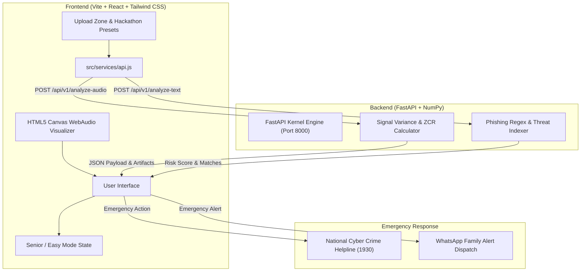

# VeriShield AI 🛡️
> **Multimodal Scam & Deepfake Defense System**


---

## 📌 Problem Overview

With the exponential surge in generative AI tools (such as ElevenLabs, VALL-E, and DeepFaceLab), cybercriminals are executing sophisticated **AI voice cloning extortion scams**, **virtual kidnapping fraud**, and **bank KYC phishing**.

* **Elderly Financial Exploitation**: Seniors are frequently targeted with 5-second synthesized voice samples of their relatives claiming to be jailed or in a car accident.
* **Psychological Pressure**: Attackers use extreme urgency, threatening language, and spoofed caller IDs to prevent victims from double-checking.
* **Lack of Instant Tools**: Victims lack accessible, real-time verification tools to confirm voice/video authenticity before sending money.

**VeriShield AI** bridges this critical security gap by providing on-device biometric verification, real-time spectral vocoder inspection, a high-contrast **Senior / Easy Mode**, and direct integration with the **National Cyber Crime Helpline (1930)**.

---

## ✨ Key Features

| Feature | Description |
| :--- | :--- |
| 🎙️ **Voice Clone Detector** | Analyzes Mel-Frequency Cepstral Coefficients (MFCC), pitch jitter variance, and synthetic zero-breathing gaps to flag AI voice clones. |
| 📹 **Deepfake Face Scanner** | 3D facial wireframe mesh overlay inspecting GAN boundary artifacts, blink rates, and temporal frame consistency. |
| 💬 **Phishing & SMS Check** | FastAPI NLP regex engine scanning message bodies for urgency triggers, bank spoofing, and malicious `.top` domain extensions. |
| 🔴 **Live Mic Guardian** | Continuous real-time audio stream monitor utilizing Web Audio API `AudioContext` to flag live call voice synthesis attacks. |
| 👁️ **Senior / Easy Mode Adapter** | Global state switch scaling typography, removing technical jargon ("MFCC", "Vocoder"), and displaying high-contrast plain instructions. |
| 🚨 **Emergency Helpline Dispatch** | Instant one-touch hotline trigger for **National Cyber Crime Portal (1930)** and pre-filled WhatsApp emergency family alerts. |
| 📊 **Forensic Report Generator** | Exportable, timestamped forensic audit text/PDF reports with unique Scan IDs (`#VS-2026-XXXX`). |

---

## 🏗️ System Architecture



---

## ⚙️ Installation & Setup

### Prerequisites
* **Node.js**: v18.0.0 or higher
* **Python**: 3.9+ with `pip`

### 1. Repository Setup & Frontend Installation
```bash
# Clone repository
git clone https://github.com/susmitha/verishield-ai.git
cd verishield-ai

# Install Node dependencies
npm install

# Start Vite React Dev Server
npm run dev
```
> The frontend application will launch at `http://localhost:5173` (or next available port).

### 2. Backend Installation & Server Launch
```bash
# Navigate to root directory
cd verishield-ai

# Install Python requirements
python3 -m pip install --break-system-packages -r backend/requirements.txt

# Start FastAPI Uvicorn Server
python3 -m uvicorn backend.main:app --host 0.0.0.0 --port 8000
```
> The backend service will be active at `http://localhost:8000`. API documentation is available at `http://localhost:8000/docs`.

---

## 🏆 Hackathon Judge Evaluation Guide

To evaluate VeriShield AI during judging, click any of the **3 One-Click Hackathon Presets** in the Upload Zone:

| Preset Scenario | Expected Risk Score | Status Badge | Key Forensic Findings |
| :--- | :--- | :--- | :--- |
| 🚨 **Grandson Emergency Bail Scam** | **94%** | `CRITICAL AI CLONE` | Neural Vocoder signature detected, artificial zero-breathing gaps, flatlining pitch contour. |
| ⚠️ **Urgent Bank KYC Expired SMS** | **88%** | `PHISHING WARNING` | Fake `.top` domain extension, 3 urgency pressure triggers, spoofed shortcode. |
| 🟢 **Legitimate Team Video Call** | **11%** | `SAFE & AUTHENTIC` | Sub-surface skin scattering, natural blink rate (14/min), 100% 3D face mesh alignment. |

---

## 📜 License

Distributed under the **MIT License**. See `LICENSE` for more information.
